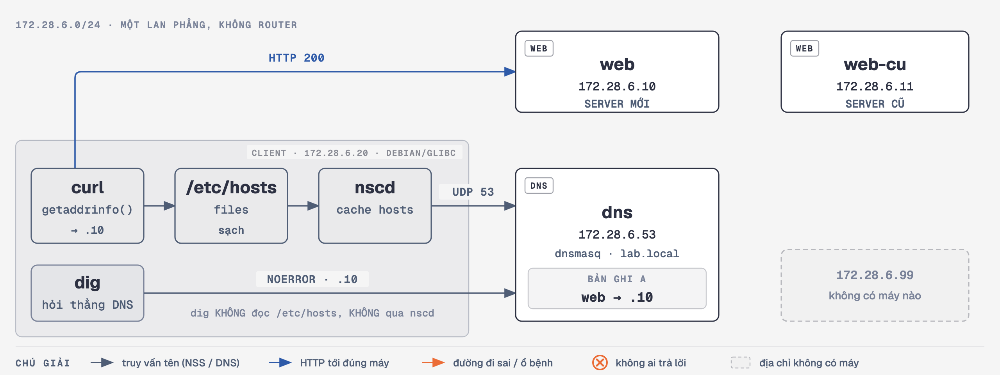

# 🩺 Ca Bệnh 06: Ping IP Thì Mượt, Gõ Tên Miền Thì Chết — Bắt Bệnh DNS

> **Hồ sơ ca bệnh:**
> * **Hiện tượng:** `ping 172.28.6.10` và `curl http://172.28.6.10` chạy mượt. Nhưng gõ `curl http://web.lab.local` thì nhận `Could not resolve host` — hoặc tệ hơn: **vẫn ra HTTP 200, chỉ là từ nhầm máy**.
> * **Bản chất lỗi:** Sự cố ở **Tầng 7 — khâu phân giải tên**. Mọi thứ ở L2/L3/L4 đều đúng tuyệt đối.
> * **Chỗ khiến ca này khó lần:** "DNS lỗi" không phải một bệnh, nó là **tám bệnh khác nhau** dùng chung vài câu thông báo. `curl` trả về cùng một dòng `Could not resolve host` cho hai nguyên nhân trái ngược nhau. Và ba trong tám ca **không hề báo lỗi gì cả** — chúng trả về HTTP 200 từ sai địa chỉ.

> 🧪 **Lab có DNS server thật (dnsmasq), không dùng resolver nhúng của Docker.** 8 kịch bản chia 4 nhóm theo **chữ ký chẩn đoán**, không phải theo nguyên nhân:
>
> | Nhóm | KB | Chữ ký `dig` | `curl` |
> | :--- | :-- | :--- | :--- |
> | **A. Khoẻ** | 1 | `NOERROR`, IP đúng | 200 |
> | **B. Resolver câm** | 2, 3 | `timed out` 2000ms / `connection refused` 20ms | 28 / 6 |
> | **C. Trả lời sai** | 4, 5, 6 | `NXDOMAIN` / `timed out` / `NOERROR` + **IP sai** | 6 / 6 / **200** |
> | **D. Không phải DNS server** | 7, 8 | `NOERROR`, **IP đúng** | **200 nhưng nhầm máy** |

> 📚 **Điều kiện tiên quyết:** Nắm `ping`, `curl`, `dig` ở mức cơ bản. Đây là ca bệnh **Tầng 7** đầu tiên của series.

---

## 🔬 Sơ đồ Kiến trúc Lab



> 🖼️ **Bản HTML tương tác** — 8 tab, mỗi tab một kịch bản, thấy ổ bệnh nằm ở chặng nào
> (`curl` → `/etc/hosts` → `nscd` → DNS, hay `dig` hỏi thẳng DNS):
> [`so-do-kien-truc.html`](./so-do-kien-truc.html)

* **`client` dùng glibc (Debian), không dùng musl (Alpine).** Resolver là một phần của libc — đổi libc là đổi hành vi. Xem [callout bên dưới](#-musl-vs-glibc--cùng-một-resolvconf-hai-kết-quả).
* **Client trỏ thẳng vào `172.28.6.53`, không dùng DNS nhúng `127.0.0.11` của Docker.** Nhờ vậy mọi hành vi phân giải nằm trong tầm kiểm soát của script, và **lab chạy được cả khi máy bạn rút mạng**.
* **`web-cu` là đích sai còn sống.** Nó tồn tại để dựng được ca nguy hiểm nhất: DNS trả lời trót lọt, HTTP 200, mà người dùng đang xem nhầm server.
* **`.99` là địa chỉ không có máy nào** — dùng cho ca "resolver không tới được" và "DNS trả về địa chỉ chết".

> 🔑 Cả tập gói trong một câu: **`dig` chạy tốt KHÔNG có nghĩa là DNS đúng.**

---

## 🚀 Hướng Dẫn Thực Hành

### Bước 1: Dựng lab

```bash
cd network-bat-benh/tap-06-dns-resolution-failure
./scripts/0-setup.sh
```

`0-setup.sh` **idempotent** — chạy lại bất cứ lúc nào để reset sạch. Nó dọn cả những thứ mà `docker compose restart` không dọn được: dòng thừa trong `/etc/hosts`, bộ đệm `nscd`, zone bị sửa, forwarder chết, `resolv.conf` bị trỏ sai.

> **Quy tắc bất di bất dịch: sau MỖI kịch bản, chạy lại `./scripts/0-setup.sh`.**

Ba terminal nên mở sẵn suốt buổi:

```bash
# Terminal 1 — chạy kịch bản
./scripts/0-setup.sh

# Terminal 2 — máy đo phía client (nạn nhân)
docker exec -it lab06-client monitor.sh

# Terminal 3 — góc nhìn phía DNS server (nơi phá án)
./scripts/xem-log-dns.sh
```

> ⚠️ **KHÔNG dùng `docker compose logs dns`** — nó bắt được **0 dòng**. dnsmasq được khởi động bằng `docker exec` nên không phải PID 1 của container; log nằm trong file. Dùng `./scripts/xem-log-dns.sh`.

---

### Bước 2: Chạy một ca bệnh và đọc chữ ký

```bash
./scripts/2-resolver-khong-toi-duoc.sh     # hoặc 1..8
./scripts/test.sh                          # chẩn đoán 7 bước, tự luận giải
```

`test.sh` chạy được ở **bất kỳ trạng thái nào** của lab và tự chỉ ra kịch bản nào đang chạy.

> ⚠️ `test.sh` mặc định hỏi `web.lab.local`. Hai kịch bản hỏi **tên khác** — phải truyền tên, nếu không `test.sh` sẽ báo "khoẻ":
> * KB4: `./scripts/test.sh wed.lab.local`
> * KB5: `./scripts/test.sh db.noi-bo.local`
>
> Cuối output của hai script này đều in sẵn lệnh cần chạy.

---

### Bước 3: Bắt gói tin

```bash
./scripts/bat-goi-dns.sh 12                # 12 giây, xuất .pcap ra thư mục tập
```

Mở file `.pcap` bằng Wireshark, display filter: `dns`

| Thấy gì trong Wireshark | Nghĩa là |
| :--- | :--- |
| Chỉ có `Standard query`, **không có** response | Không ai trả lời — KB2 hoặc KB5 |
| `query response ... No such name` | NXDOMAIN — KB4 |
| `query response A 172.28.6.11` | Có trả lời, nhưng **sai IP** — KB6 |
| **Không có gói nào cả** | Ứng dụng chưa hề hỏi DNS — KB7 hoặc KB8 |

Bắt gói **trong container** nên chạy giống nhau trên macOS/Windows/Linux (xem [mục Wireshark ở README series](../README.md#-bắt-gói-tin-bằng-wireshark-trên-mọi-hệ-điều-hành)).

---

## 🧠 Bảng Vân Tay — Thứ Đáng Học Thuộc Nhất Tập Này

Toàn bộ số liệu dưới đây **đo trong chính lab này**, không phải con số tham khảo:

```
  dig                         curl       NSS vs dig    -> Ca bệnh
  --------------------------- ---------- ------------- --------------------------
  NOERROR, IP đúng            200        khớp          KHOẺ
  timed out (~2000 ms)        exit 28    -             KB2 resolver không tới được
                                                       (log server: 0 query)
  timed out (~2000 ms)        exit 6     -             KB5 forwarder chết
                                                       (log server: CÓ query)
  connection refused (~20 ms) exit 6     -             KB3 dịch vụ DNS chết
  NXDOMAIN (~0 ms)            exit 6     -             KB4 không có bản ghi
  NOERROR, IP SAI             200 / 28   khớp          KB6 DNS trả sai địa chỉ
  NOERROR, IP đúng            200        LỆCH          KB7 /etc/hosts đè lên
  NOERROR, IP mới             200        LỆCH (cũ)     KB8 bộ đệm giữ IP cũ
```

Ba cặp dễ nhầm nhất — và cách tách:

1. **KB3 vs KB4** — `curl` nói **y hệt** nhau: `curl: (6) Could not resolve host`. Nguyên nhân trái ngược (dịch vụ chết / bản ghi thiếu). **`curl` không đủ để chẩn đoán, phải `dig`.**
2. **KB2 vs KB5** — `dig` nói **y hệt** nhau: `timed out` sau ~2000 ms. Không lệnh nào chạy *trên client* tách được. **Chỉ log phía server trả lời được:** 0 query = gói chưa tới nơi (KB2); có query = gói tới nơi rồi, server mới là bên không trả lời được (KB5).
3. **KB6 vs KB7/KB8** — cả ba đều HTTP 200 từ nhầm máy. Tách bằng: `dig @<IP DNS thật>` và `getent hosts` có **lệch nhau** không. Khớp → lỗi ở DNS server (KB6). Lệch → thủ phạm nằm **trên máy client** (KB7 `/etc/hosts`, KB8 bộ đệm).

---

## 🧭 Quy Trình Debug DNS — 5 Bước, Đúng Thứ Tự

```
1. Loại trừ tầng dưới:   ping <IP đích>          -> thông = L3 OK, đừng soi mạng nữa.
2. Client đang hỏi ai:   resolvectl status        (Ubuntu 24.04+, xem dòng "DNS Servers")
                         cat /etc/resolv.conf     (thấy 127.0.0.53 = đang đi qua systemd-resolved)
3. ỨNG DỤNG dùng IP nào: getent hosts <tên>       <- đi ĐÚNG đường ứng dụng đi
4. DNS SERVER nói gì:    dig @<IP DNS thật> <tên> <- hỏi THẲNG server ở bước 2, vượt mọi lớp đệm
5. So bước 3 với bước 4: lệch  -> thủ phạm TRÊN MÁY CLIENT (hosts / nscd / systemd-resolved)
                         khớp  -> hỏi tiếp: IP đó có ĐÚNG không? (KB6)
```

> ⚠️ **Bước 3 là bước hay bị bỏ nhất và là bước quan trọng nhất.** `dig` **không** đọc `/etc/hosts`, **không** đi qua `nscd` — nhưng **có** đi qua `systemd-resolved` nếu `resolv.conf` trỏ `127.0.0.53`, nên bước 4 phải có `@<IP DNS thật>`. Nó nói cho bạn biết DNS server nghĩ gì — không phải ứng dụng của bạn đang làm gì. Ticket bị đóng nhầm với dòng "dig kiểm tra thấy bình thường" là ticket KB7 hoặc KB8.

> 🐧 **Ghi chú Ubuntu Server 24.04+** — Quy trình trên viết cho Ubuntu Server 24.04 trở về sau. Mặc định trên các bản này: `systemd-resolved` chạy sẵn, `/etc/resolv.conf` trỏ `nameserver 127.0.0.53`, còn `nscd` **không** được cài. Hệ quả:
> * `dig <tên>` không có `@` là hỏi `127.0.0.53` — tức hỏi **chính bộ đệm** của `systemd-resolved`, không phải DNS server. Nếu bộ đệm đang giữ IP cũ, bước 3 và bước 4 **khớp nhau** mà vẫn sai → bạn đổ oan cho DNS server.
> * Tìm IP DNS thật: `resolvectl status` (dòng `DNS Servers`), rồi `dig @<IP đó> <tên>`.
> * Xoá bộ đệm: `sudo resolvectl flush-caches` — tương đương `nscd -i hosts` của KB8.
>
> Lab chạy client Debian 12 **không có** `systemd-resolved`: `resolv.conf` trỏ thẳng `172.28.6.53`, nên trong lab `dig <tên>` và `dig @172.28.6.53 <tên>` cho cùng kết quả. KB8 minh hoạ bộ đệm bằng `nscd`; trên Ubuntu thật, lớp đệm bạn gặp nhiều nhất là `systemd-resolved`.

Khi `dig` báo timeout, còn **một câu hỏi nữa** phải hỏi trước khi kết luận:

```
6. Gói tin có TỚI ĐƯỢC DNS server không?   -> xem log phía server
   0 query  -> sai địa chỉ nameserver / firewall chặn UDP 53  (KB2)
   có query -> resolver nhận được rồi, lỗi nằm BÊN TRONG nó   (KB5)
```

---

## 🐧 musl vs glibc — Cùng Một `resolv.conf`, Hai Kết Quả

Resolver là một phần của libc. Đổi distro nền là đổi hành vi phân giải. Ba điều dưới đây **đã đo trong lab này**:

| | musl (Alpine) | glibc (Debian/Ubuntu/RHEL) |
| :--- | :--- | :--- |
| `/etc/hosts` đè DNS | Có | Có |
| Tôn trọng `/etc/nsswitch.conf` | **Không** — Alpine có ship file này nhưng musl bỏ qua nó | Có |
| Nhiều `nameserver`, cái đầu chết | Hỏi **song song** → trả lời sau **~0 ms** | Hỏi **lần lượt**, chờ hết timeout → **~3000 ms** |

👉 Dòng cuối là lý do một dịch vụ chuyển từ image Alpine sang Debian có thể "bỗng dưng chậm" mà **không ai đổi gì về mạng**. Lab này dùng glibc vì đó là thứ học viên gặp trên server thật.

---

## ⚠️ Bẫy Thực Địa: ICMP Rate Limit

Nếu bạn bắn `dig` liên tục nhiều lần trong một giây vào một cổng đã đóng, bạn sẽ thấy `connection refused` **thỉnh thoảng đổi thành** `timed out`.

Đó không phải bệnh đổi. Đó là `net.ipv4.icmp_ratelimit` của Linux — mặc định chỉ cho phát **1 gói ICMP unreachable mỗi giây**. Gói thứ 2 trở đi bị kernel nuốt, và "từ chối" trông y hệt "im lặng".

👉 Khi chẩn đoán, `dig` **thong thả từng lần một**. Bắn liên tục là tự làm nhiễu chính bằng chứng của mình.

---

## 🧹 Dọn dẹp Lab

```bash
docker compose down
```
