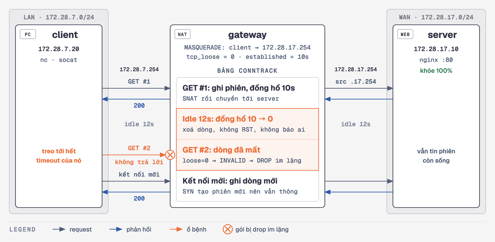
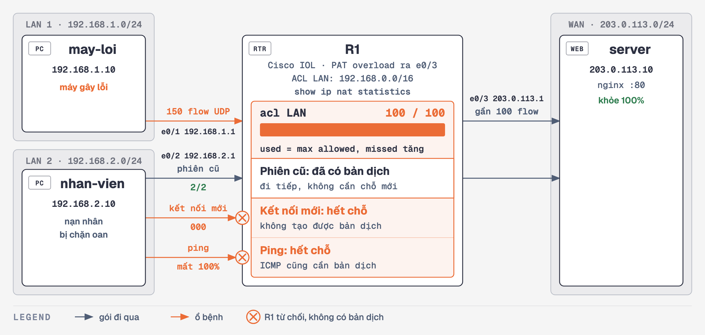

# 🩺 Ca Bệnh 07: Bảng NAT — Phiên Cũ Đứt Sau Idle, Phiên Mới Không Mở Được

> **Hồ sơ ca bệnh:**
> * **Hiện tượng 1:** SSH, Connection Pool hay WebSocket đang chạy ổn, để nghỉ vài phút rồi dùng lại thì đơ cứng. Ping và kết nối mới vẫn bình thường.
> * **Hiện tượng 2:** Đang dùng bình thường, cả công ty bỗng không mở được kết nối mới, ping ra ngoài cũng chết. Phiên đang mở từ trước thì vẫn chạy.
> * **Bản chất lỗi:** NAT/Stateful Firewall giữ một **bảng**, mỗi dòng là một phiên và có **đồng hồ riêng**. Dòng bị xoá quá sớm thì **phiên cũ chết** (NAT timeout). Bảng hết chỗ thì **phiên mới chết** (tràn bảng).
> * **Chỗ khiến ca này khó lần:** Cả hai đều không có thông báo. KB2 không có gói RST nào, KB3 không có dòng syslog `%NAT` nào. Không đọc đúng chỗ thì không biết.

> 🧪 **Hai kịch bản phổ biến nhất, tách nhau bằng một câu hỏi: phiên cũ chết hay phiên mới chết?**
>
> | KB | Ca | Phiên cũ | Phiên mới | Ping | Lab |
> | :-- | :--- | :--: | :--: | :--: | :--- |
> | KB1 | Khỏe (mốc so sánh) | 2/2 | 200 | thông | Docker |
> | **KB2** | **NAT session timeout** | **1/2** | 200 | thông | Docker, mọi máy |
> | **KB3** | **Tràn bảng NAT** | 2/2 | **000** | **mất 100%** | Cisco IOL, cần máy x86_64 |

---

## 🔬 Sơ đồ Kiến trúc Lab

> Sơ đồ đầy đủ theo từng kịch bản: mở [`so-do-kien-truc.html`](./so-do-kien-truc.html) bằng trình duyệt.

**KB2 — lab Docker:**



* **Gateway là một container riêng.** Ngoài đời NAT/firewall là **thiết bị thứ ba**: client và server không biết nó vừa xoá phiên.
* **Timeout ép xuống 10 giây** để demo nhanh. AWS NAT Gateway là 350 giây, còn mặc định của Linux là 5 ngày. Cơ chế giống hệt.
* **Lab đặt `nf_conntrack_tcp_loose=0`**, trong khi mặc định của Linux là **1**. Với giá trị 1, kernel nhặt lại gói giữa chừng thành phiên mới, nên cùng phép thử ra **2/2** và không có bệnh. Lab đặt 0 để gateway xử lý chặt như một stateful firewall. Vì vậy một NAT Linux tự dựng để mặc định sẽ khó tái hiện KB2 theo cách này.

**KB3 — lab Cisco (containerlab):**



* **Giới hạn 100 là đặt để demo nhanh** bằng `ip nat translation max-entries list LAN 100`. Giới hạn ngoài đời lớn hơn rất nhiều, nhưng cách đọc chữ ký giống nhau.
* **Image IOL không có trong repo** vì lấy từ Cisco CML. Không có image thì bạn vẫn học được KB3 qua bảng chữ ký bên dưới.

> 🔑 Cả tập gói trong một câu: **một bảng, hai kiểu chết: dòng mất sớm thì phiên cũ chết, hết chỗ thì phiên mới chết.**

---

## 🚀 Hướng Dẫn Thực Hành

### KB1 + KB2: NAT session timeout (Docker)

```bash
cd network-bat-benh/tap-07-nat-session-timeout
./scripts/0-setup.sh
```

`0-setup.sh` **idempotent** — chạy lại bất cứ lúc nào để reset sạch, và **tự khẳng định** trạng thái khỏe (2/2).

> **Quy tắc bất di bất dịch: sau MỖI kịch bản, chạy lại `./scripts/0-setup.sh`.**

```bash
# Terminal 1 — chạy kịch bản
./scripts/1-binh-thuong.sh          # mốc so sánh: 2/2
./scripts/2-nat-xoa-im-lang.sh      # ⭐ NAT xoá phiên          → 1/2, im lặng
./scripts/2b-keepalive-cuu-song.sh  # thuốc: TCP keepalive      → 2/2

# Terminal 2 — góc nhìn bảng conntrack của gateway
./scripts/xem-conntrack.sh
```

### KB3: Tràn bảng NAT (Cisco IOL)

Cần máy **Linux x86_64** có Docker. Máy ARM, gồm cả Mac Apple Silicon, không chạy được IOL. Build image một lần từ binary IOL trong Cisco CML:

```bash
git clone --depth 1 https://github.com/srl-labs/vrnetlab.git
cp x86_64_crb_linux-adventerprisek9-ms.iol vrnetlab/cisco/iol/cisco_iol-17.12.01.bin
cd vrnetlab/cisco/iol && make docker-image
```

> Tên file chỉ quyết định tag image. Binary dùng để đo trong tập này có tag `17.12.01` nhưng `show version` là **17.15.1**. Đổi image thì chạy `./scripts/test.sh` trước khi dùng, vì hành vi bộ đếm thay đổi theo bản IOS.

Chạy kịch bản. Có sẵn `containerlab` thì script dùng luôn, không thì tự chạy image `ghcr.io/srl-labs/clab`:

```bash
cd network-bat-benh/tap-07-nat-session-timeout/cisco
./scripts/0-setup.sh                # dựng lại lab từ đầu, chạy trước mỗi lần demo
./scripts/3-tran-bang-nat.sh        # ⭐ bảng đầy                → phiên mới 000
./scripts/3b-gioi-han-theo-may.sh   # thuốc: giới hạn theo máy   → nhan-vien 200
./scripts/test.sh                   # khẳng định toàn bộ chữ ký
./scripts/don-dep.sh                # xoá lab, giữ image
```

Terminal 2: `./scripts/xem-bang-nat.sh` để xem bảng NAT của R1 đầy dần.

---

## 🧠 Bảng Vân Tay — Thứ Đáng Học Thuộc Nhất Tập Này

Toàn bộ số liệu dưới đây **đo trong chính lab này**:

| | KB2 — NAT timeout | KB3 — Tràn bảng |
| :--- | :--- | :--- |
| Phiên đang mở | **chết sau idle** (1/2) | vẫn sống (2/2) |
| Kết nối mới | 200 | **000** |
| Ping | thông | **mất 100%** |
| Ai bị | phiên idle lâu hơn timeout | mọi máy dùng chung bảng |
| Client thấy gì | treo tới hết timeout của nó | kết nối mới treo tới hết timeout của nó |
| Bằng chứng | entry biến mất khỏi `conntrack -L` | `used` bằng `max allowed`, `missed` tăng |
| Thuốc | TCP keepalive | giới hạn theo máy, tìm máy gây lỗi |

**KB3 đọc ở đâu — `show ip nat statistics`:**

```text
Total active translations: 100 (0 static, 100 dynamic; 100 extended)
nat-limit statistics:
 max entry: max allowed 0, used 0, missed 0
 acl LAN: max allowed 100, used 100, missed 58
```

Sau khi chữa, đọc dòng `host`:

```text
Total active translations: 20 (0 static, 20 dynamic; 20 extended)
 acl LAN: max allowed 100, used 0, missed 58
 host 192.168.1.10: max allowed 20, used 20, missed 130
```

Bảng này có vài điểm dễ đọc nhầm:

* **`missed` cộng dồn:** `clear ip nat translation *` không reset bộ đếm này.
* **Bản dịch tính theo `host` không cộng vào `acl LAN`:** nên sau khi chữa, `acl LAN` chỉ còn `used 0`.
* **Các loại giới hạn không giống nhau.** Đo trên IOL 17.15.1:

| Lệnh | Có chặn không | Bộ đếm `used` / `missed` |
| :--- | :--: | :--- |
| `max-entries list LAN 100` | ✅ | ✅ đếm đúng |
| `max-entries host <ip> 20` | ✅ | ✅ đếm đúng |
| `max-entries 100` | ✅ | ❌ luôn `used 0, missed 0` |
| `max-entries all-host 20` | ❌ bảng lên tới 150 | không có |

> Đây là hành vi của bản IOL này, không phải của mọi thiết bị Cisco. Trên thiết bị khác, kiểm tra lại trước khi tin vào một bộ đếm bằng 0.

**Ngoài đời triệu chứng KB2 còn tuỳ thiết bị:** Linux drop im lặng nên client treo tới hết timeout của nó. AWS NAT Gateway thì trả **RST** cho gói đến sau khi phiên hết hạn, nên ứng dụng thấy `Connection reset by peer`.

---

## 🧭 Quy Trình Debug — Bắt Đầu Từ Một Câu Hỏi

```text
1. Phiên CŨ chết hay phiên MỚI chết?
     - Phiên cũ chết sau idle, kết nối mới vẫn chạy   -> nhánh TIMEOUT
     - Kết nối mới chết, ping chết, phiên cũ còn sống -> nhánh TRÀN BẢNG

Nhánh TIMEOUT
2. Có gói FIN/RST không?       -> tcpdump ở CẢ HAI đầu: có FIN = server/app đóng
                                                        im lặng = NAT/firewall xoá
3. Entry còn trong bảng?       -> Linux: conntrack -L
4. Đã bật keepalive chưa?      -> nếu rồi: keepidle có NHỎ HƠN timeout NAT không?

Nhánh TRÀN BẢNG
2. Bảng có đầy thật không?     -> show ip nat statistics: used = max allowed, missed tăng
3. Ai đang chiếm chỗ?          -> show ip nat translations, đếm theo IP bên trong
4. Vì sao máy đó nhiều flow?   -> app rò rỉ socket, quét mạng, malware
```

> ⚠️ **Đừng khởi động lại thiết bị trước khi đọc thống kê.** Việc đó xoá sạch bảng nên mạng chạy lại được một lúc, nhưng nguyên nhân vẫn còn và bằng chứng đã mất.

---

## 🩹 Đơn Thuốc

**KB2 — NAT session timeout**

1. **TCP Keepalive ở ứng dụng / Database Pool** — interval **nhỏ hơn** timeout của gateway (HikariCP, SQLAlchemy, GORM, Knex).
2. **SSH client** — `~/.ssh/config`:
   ```ssh
   Host *
       ServerAliveInterval 60
       ServerAliveCountMax 3
   ```
3. **Linux kernel (toàn máy)**:
   ```bash
   sysctl -w net.ipv4.tcp_keepalive_time=60
   sysctl -w net.ipv4.tcp_keepalive_intvl=10
   sysctl -w net.ipv4.tcp_keepalive_probes=3
   ```

> ⚠️ **Liều lượng quyết định tất cả:** `keepidle` lớn hơn timeout NAT thì vẫn chết như không bật. Đây là bẫy mặc định: Linux để `tcp_keepalive_time=7200` (2 giờ), lớn hơn hẳn 350 giây của AWS NAT Gateway, nên chỉ bật `SO_KEEPALIVE` mà không chỉnh số là chưa đủ. `tcp_keepalive_*` cũng chỉ áp dụng cho socket **có bật `SO_KEEPALIVE`**.

**KB3 — Tràn bảng NAT**

1. **Khoanh vùng ngay** — giới hạn máy gây lỗi để người khác dùng lại được:
   ```
   ip nat translation max-entries host 192.168.1.10 20
   ```
   Giải phóng bảng bằng `clear ip nat translation *` sẽ **cắt luôn mọi phiên đang chạy**. Trên production, ưu tiên xoá theo từng máy.
2. **Chữa gốc** — tìm vì sao máy đó tạo nhiều flow: app rò rỉ socket, không dùng lại connection, malware.
3. **Rút ngắn đời của bản dịch** — `ip nat translation udp-timeout`, `tcp-timeout`. Trên Cisco, timeout mặc định 24 giờ khiến bản dịch không còn dùng vẫn giữ chỗ rất lâu. Bước này chưa được đo riêng trong lab.
4. **Đặt cảnh báo** — router không ghi syslog `%NAT` khi đầy, nên phải giám sát tỷ lệ `used / max allowed` và `missed`.

> Bệnh họ hàng trên cloud: **cạn cổng SNAT**. Bảng chưa đầy mà kết nối tới **cùng một đích** vẫn lỗi, đích khác thì không. AWS NAT Gateway giới hạn 55.000 kết nối đồng thời trên mỗi IP tới mỗi đích.

---

## 📋 Bảng Script

| Script | Việc |
| :--- | :--- |
| `scripts/0-setup.sh` | Reset lab Docker về trạng thái khỏe. Chạy sau mỗi kịch bản. |
| `scripts/1-binh-thuong.sh` | KB1: mốc so sánh |
| `scripts/2-nat-xoa-im-lang.sh`, `2b-keepalive-cuu-song.sh` | KB2: bệnh và thuốc |
| `scripts/xem-conntrack.sh` | Góc nhìn bảng conntrack của gateway |
| `scripts/test.sh` | Chạy KB1, KB2 và thuốc, khẳng định từng chữ ký |
| `cisco/scripts/0-setup.sh` | Dựng lại lab Cisco từ đầu |
| `cisco/scripts/3-tran-bang-nat.sh`, `3b-gioi-han-theo-may.sh` | KB3: bệnh và thuốc |
| `cisco/scripts/xem-bang-nat.sh` | Góc nhìn bảng NAT của R1 |
| `cisco/scripts/test.sh` | Khẳng định chữ ký KB3 (khoảng 1 phút) |
| `cisco/scripts/don-dep.sh` | Xoá lab Cisco, giữ image |

---

## 📝 Câu Hỏi Ôn Tập

1. Người dùng báo "mạng chập chờn". Câu hỏi đầu tiên nào tách được KB2 khỏi KB3, và vì sao?
2. Cùng phép thử KB2, vì sao gateway đặt `tcp_loose=0` ra 1/2 còn Linux để mặc định lại ra 2/2?
3. Khi bảng đầy, vì sao phiên cũ vẫn chạy còn ping lại chết?
4. `show ip nat statistics` báo `max entry: used 0, missed 0` nhưng kết nối mới vẫn chết. Có nên kết luận NAT không có lỗi không?
5. Tăng timeout lên thật lớn chữa được KB2. Vì sao cách đó có thể gây ra KB3?
6. Bạn không có quyền vào NAT Gateway của nhà mạng. Với KB2, kể ra cách chữa bạn **có thể** làm.

---

## 🧹 Dọn dẹp Lab

```bash
docker compose down -v              # lab Docker
./cisco/scripts/don-dep.sh          # lab Cisco
```
