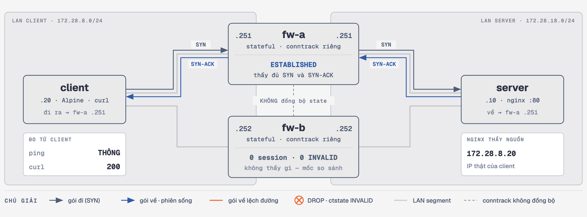

# 🩺 Ca Bệnh 08: Asymmetric Routing — Ping Thông 2 Chiều Nhưng Không Vào Được Web/SSH

> **Hồ sơ ca bệnh:**
> * **Hiện tượng:** Từ client `ping` server: 0% loss. Từ server `ping` ngược lại: 0% loss. Nhưng mở SSH hoặc Web thì đứng im, rớt ngay từ bước bắt tay.
> * **Bản chất lỗi:** **Định tuyến bất đối xứng (Asymmetric Routing) gặp thiết bị stateful.** Gói `SYN` đi qua Firewall A (tạo session), gói `SYN-ACK` về theo tuyến khác qua Firewall B. B chưa từng thấy `SYN` nên coi gói là `INVALID` và DROP.
> * **Chỗ khiến ca này khó lần:** Bất đối xứng **tự nó không phải lỗi** — Internet chạy như vậy. Lỗi chỉ xuất hiện khi có **thiết bị giữ trạng thái** trên đường đi, và **firewall bạn thấy DROP chưa chắc là firewall cần sửa**.

> 🧪 **Cấu trúc buổi học — 1 ca bệnh kinh điển và 2 đơn thuốc thực tế:**
>
> | Kịch bản | Vai trò | Đường về | `ping` | `curl` | `INVALID` DROP | Server thấy nguồn |
> | :--- | :--- | :---: | :---: | :---: | :---: | :--- |
> | **KB1** (`1-binh-thuong.sh`) | Mốc khỏe (đối xứng) | `fw-a` | thông | **200** | — | `172.28.8.20` (client) |
> | **KB2** (`2-bat-doi-xung-stateful.sh`) | ⭐ **Bất đối xứng + Stateful FW** | **`fw-b`** | thông | **000** | **`fw-b`** | *(chưa bắt tay xong)* |
> | **Thuốc 2a** (`2a-chua-route.sh`) | 💊 **Chữa gốc:** Sửa bảng route | `fw-a` | thông | **200** | — | `172.28.8.20` (client) |
> | **Thuốc 2b** (`2b-chua-snat.sh`) | 💊 **Chữa tình thế:** SNAT tại `fw-a` | `fw-b` | thông | **200** | — | `172.28.18.251` (`fw-a`) |

---

## 🔬 Sơ đồ Kiến trúc Lab

> 🖼️ **Sơ đồ tương tác theo từng kịch bản:** mở [`so-do-kien-truc.html`](./so-do-kien-truc.html) hoặc [`simulation.html`](./simulation.html) bằng trình duyệt.



```text
                     +----[ fw-a  .251 | .251 ]----+
   LAN client        |   stateful, conntrack riêng  |        LAN server
   172.28.8.0/24 ---+                              +--- 172.28.18.0/24
   client .20        |                              |        server .10
                     +----[ fw-b  .252 | .252 ]----+
                         stateful, conntrack riêng

   SYN      : client --> fw-a --> server              (route tĩnh trên client)
   SYN-ACK  : server --> fw-a (khoẻ)  |  fw-b (BỆNH)  (route tĩnh trên server)
```

* **Hai router stateful THẬT.** Mỗi firewall là một container riêng, giữ bảng `conntrack` **riêng**, không đồng bộ với nhau.
* **Ổ bệnh là một dòng route trên server** (`ip route replace 172.28.8.0/24 via <fw-a|fw-b>`). Ngoài đời tình huống này xảy ra khi dựng thêm tuyến VPN/Direct Connect mới, cắm thêm firewall thứ 2, đặt sai default gateway trên server, hoặc BGP/OSPF chọn đường đi và đường về khác nhau.
* **`ping` thông vì luật cho ICMP qua không xét trạng thái** (`-p icmp -j ACCEPT` đứng trước luật `INVALID`) — nhiều firewall thật cấu hình y vậy để tiện kiểm tra kết nối. Nếu ICMP cũng đi qua conntrack thì `echo-reply` về lệch đường cũng bị DROP và `ping` chết theo.
* **Lab đặt `nf_conntrack_tcp_loose=0`** để firewall xử lý chặt như thiết bị thương mại. Lưu ý: kể cả để mặc định của Linux (`tcp_loose=1`), KB2 **vẫn chết y hệt** vì conntrack không bao giờ chấp nhận `SYN-ACK` làm gói đầu tiên của một phiên mới.

> 🔑 Cả tập gói trong một câu: **"Firewall nào DROP" chưa phải bằng chứng "firewall đó cần sửa" — hỏi tiếp: đường đi và đường về có cùng đi qua thiết bị giữ trạng thái đó không?**

---

## 🚀 Hướng Dẫn Thực Hành

```bash
cd network-bat-benh/tap-08-asymmetric-routing
./scripts/0-setup.sh
```

`0-setup.sh` **idempotent** — chạy lại bất cứ lúc nào để reset sạch về trạng thái khỏe (`curl 200`).

> **Quy tắc bất di bất dịch: sau MỖI kịch bản, chạy lại `./scripts/0-setup.sh`.**

```bash
# Terminal 1 — chạy kịch bản
./scripts/1-binh-thuong.sh                # KB1: mốc so sánh (đối xứng)      → curl 200
./scripts/2-bat-doi-xung-stateful.sh      # ⭐ KB2: bất đối xứng qua 2 FW   → ping thông, curl 000
./scripts/2a-chua-route.sh                # 💊 Thuốc 2a (gốc): sửa route    → curl 200, giữ IP thật
./scripts/2b-chua-snat.sh                 # 💊 Thuốc 2b (che): SNAT ở fw-a  → curl 200, mất IP thật

# Terminal 2 — góc nhìn bảng conntrack + bộ đếm INVALID của cả hai firewall
./scripts/xem-firewall.sh

# Kiểm chứng tự động toàn bộ chữ ký trong README
./scripts/test.sh
```

---

## 🧠 Bảng Vân Tay — Thứ Đáng Học Thuộc Nhất Tập Này

Toàn bộ số liệu dưới đây **đo trong chính lab này**:

| Chỉ số | KB1 — Đối xứng (Khỏe) | KB2 — Bất đối xứng (Bệnh) | Thuốc 2a — Sửa Route (Gốc) | Thuốc 2b — SNAT tại `fw-a` (Che) |
| :--- | :--- | :--- | :--- | :--- |
| **Luồng gói `SYN`** | `client → fw-a → server` | `client → fw-a → server` | `client → fw-a → server` | `client → fw-a (SNAT) → server` |
| **Luồng gói `SYN-ACK`** | `server → fw-a → client` | **`server → fw-b (DROP)`** | `server → fw-a → client` | `server → fw-a → client` |
| **`ping` 2 chiều** | thông | **thông** | thông | thông |
| **`curl` (TCP :80)** | **200** | **000** (timeout bắt tay) | **200** | **200** |
| **Bảng `conntrack` ở `fw-a`** | `ESTABLISHED` | **`SYN_SENT [UNREPLIED]`** | `ESTABLISHED` | `ESTABLISHED` |
| **Bộ đếm `INVALID` ở `fw-b`** | `0` | **`> 0` (tăng mỗi lần retry)** | `0` | `0` |
| **Nginx log thấy nguồn là** | `172.28.8.20` (IP thật) | *(không có log)* | `172.28.8.20` (IP thật) | **`172.28.18.251` (mất IP thật)** |

### 🪤 Hai cái bẫy kinh điển khi đi chữa KB2

1. **Bẫy 1 — "Thấy `fw-b` DROP thì mở thông `fw-b`":**
   Phản xạ tự nhiên của người vận hành khi thấy counter `INVALID` tăng trên `fw-b` là tắt kiểm tra trạng thái (hoặc thêm rule `ACCEPT` thẳng) trên `fw-b`.
   * **Kết quả:** `curl` **vẫn `000`**, nhưng counter `INVALID` **nhảy từ `fw-b` sang `fw-a`**!
   * **Tách hai ca khi `http_code` giống nhau — đọc `curl -v`:** KB2 dừng ở `Connection timed out after 3007 milliseconds` (không bao giờ có dòng `Connected`). Bẫy 1 in `Connected to 172.28.18.10 port 80` rồi mới `Operation timed out ... with 0 bytes received`: client **tin** bắt tay đã xong, gói `ACK`/dữ liệu của nó mới là thứ bị `fw-a` nuốt.
   * **Vì sao:** `SYN-ACK` lọt qua `fw-b` về tới client. Client gửi gói thứ 3 của bắt tay (`ACK`) đi qua **`fw-a`**. Vì `fw-a` mới chỉ thấy `SYN`, chưa từng thấy `SYN-ACK`, nó coi gói `ACK` là `INVALID` và DROP. **Chỉ cần MỘT thiết bị stateful trên một trong hai đường là đủ chết.**
2. **Bẫy 2 — "Bật `nf_conntrack_tcp_loose=1` như Tập 07":**
   Ở Tập 07 KB2 (phiên đứt sau idle timeout), `tcp_loose=1` cho phép kernel nhặt lại gói `ACK` dữ liệu giữa phiên thành phiên mới. Nhưng ở Tập 08, gói đầu tiên chạm mặt `fw-b` là **`SYN-ACK`**. Trong bảng chuyển trạng thái TCP của conntrack, `SYN-ACK` không bao giờ được phép mở phiên mới dù `tcp_loose` bằng `0` hay `1` — `fw-b` vẫn DROP như thường.

> 💡 **Còn nếu lệch tuyến xảy ra GIỮA PHIÊN đang chạy?** (BGP/OSPF hội tụ lại, failover, link flap): Phiên đã bắt tay xong trên `fw-a`, khi route của server đột ngột bẻ sang `fw-b`, phản hồi HTTP tiếp theo đi qua `fw-b` cũng bị DROP là `INVALID` — người dùng thấy *"đang chạy bình thường tự nhiên đơ giữa chừng"*.

---

## 🧭 Quy Trình Debug — 4 Bước

```text
1. Ping thông, TCP chết:   ping <server> ; curl -v <server>       -> nghi bất đối xứng + stateful
2. Đường đi VÀ đường về:   (client) traceroute -I -n <server>     -> đường đi (hop 1: fw-a .251)
                           (server) traceroute -I -n <client>     -> đường về (hop 1: fw-b .252 != fw-a)
3. Ai giữ trạng thái:      conntrack -L trên thiết bị của CẢ HAI đường
                           • fw-a: SYN_SENT [UNREPLIED]  (thấy SYN đi, không thấy SYN-ACK về)
                           • fw-b: counter INVALID tăng  (nhận SYN-ACK của phiên chưa từng thấy)
                            Trên firewall thương mại (không có `conntrack -L`), tìm log/counter tương đương:
                            • Cisco ASA : %ASA-6-106015 "Deny TCP (no connection) ... flags SYN ACK"
                            • FortiGate : diagnose debug flow -> "no session matched"
                            • Palo Alto : show counter global | match non_syn
4. Chữa:                   Sửa route (gốc)  >  SNAT (tình thế)  >  Đồng bộ state / state bypass
```

> 🧪 Chữ ký của ba hãng trên là kiến thức tham khảo, **không đo trong lab này** (lab chỉ có Linux `conntrack`). Tên log/counter có thể đổi theo phiên bản, hãy tra tài liệu hãng khi gặp thật.

> ⚠️ **Bước 2 bắt buộc phải đo từ CẢ HAI đầu** (và dùng cờ `-I` ICMP nếu firewall chặn UDP port cao). Chỉ `traceroute` từ client chỉ cho thấy đường đi — trong khi đường về mới là thứ bị lệch.
>
> 🏢 **Ngoài đời không phải lúc nào cũng có shell trên server** (server của đội khác, đường về do ISP quyết định). Khi đó chụp gói (`tcpdump`) hoặc đọc flow log ở **cả hai firewall**: thấy `SYN` ở A mà `SYN-ACK` lại xuất hiện ở B là đủ kết luận.

### 🏭 Ca bất đối xứng phổ biến nhất ngoài đời — không nằm trong lab
Server có **hai NIC** (một quản trị, một dữ liệu) nhưng chỉ một default gateway: khách vào bằng NIC dữ liệu, phản hồi lại đi ra NIC quản trị. Với server Linux còn phải tính **`rp_filter`**: RHEL/CentOS mặc định `1` (strict) sẽ drop luôn gói vào "sai NIC", kể cả `ping`; Ubuntu mặc định `2` (loose). Cách chữa chuẩn là policy routing (`ip rule` + bảng route riêng cho mỗi NIC).

---

## 🩹 Đơn Thuốc Thực Tế — Khi Nào Dùng Cách Nào?

### 1. Thuốc 2a — Sửa bảng định tuyến (Chữa tận gốc)
* **Khi nào dùng:** Bạn quản trị cả hai đầu (hoặc làm chủ hệ thống định tuyến nội bộ / VPN / VPC).
* **Cách làm:** Chỉnh static route, metric OSPF hoặc BGP Local Preference / MED để lưu lượng đi và về đi qua **cùng một firewall**:
  ```bash
  # Trên server (trong lab): trả lưu lượng về LAN client qua fw-a thay vì fw-b
  ip route replace 172.28.8.0/24 via 172.28.18.251
  ```
* **Ưu điểm:** Không tốn tài nguyên NAT, giữ nguyên IP thật của client trong log và ACL của server.

### 2. Thuốc 2b — Bật SNAT tại Firewall chiều đi (Chữa tình thế / Workaround)
* **Khi nào dùng:** Bạn **không có quyền sửa route trên server** (server của đối tác, nhánh mạng qua ISP khác, hoặc thiết bị legacy có default gateway cố định trỏ sang đường khác).
* **Cách làm:** Bật `SNAT` / `MASQUERADE` tại `fw-a` cho lưu lượng sang server:
  ```bash
  # Trên fw-a: thay IP nguồn của gói tin thành IP chân trong của fw-a (.251)
  iptables -t nat -A POSTROUTING -s 172.28.8.0/24 -d 172.28.18.0/24 -j MASQUERADE
  ```
  Khi đó server nhìn thấy nguồn gói `SYN` là `172.28.18.251` (`fw-a`, nằm cùng subnet với server) nên trả `SYN-ACK` thẳng về `fw-a`, ép luồng mạng tự đối xứng mà không cần đụng vào bảng route của server.
* **Cái giá phải trả:** Server **mất IP thật của client** — toàn bộ access log, rate-limit, hay IP whitelist trên server đều chỉ thấy IP của `fw-a`.

### 3. Đồng bộ trạng thái (Active/Active State Sync)
* **Khi nào dùng:** Kiến trúc mạng bắt buộc chạy ECMP hoặc định tuyến bất đối xứng qua 2 firewall song song để chia tải / dự phòng.
* **Cách làm:** Ghép cặp HA Active/Active có đồng bộ bảng session (`conntrackd` trên Linux, FGSP trên FortiGate, cluster trên ASA / Check Point).
* **Lưu ý:** Đồng bộ session thường **bất đồng bộ** — `SYN-ACK` có thể tới firewall B **trước khi** session từ A kịp sync sang, và vẫn bị DROP. Vì vậy một số hãng chuyển luôn gói sang firewall đang giữ session thay vì chỉ sync bảng. Lab này **không dựng** cơ chế đó.

### 4. State bypass — tắt kiểm tra trạng thái cho đúng luồng bị lệch
* **Khi nào dùng:** Không sửa được route, không dùng được SNAT (cần giữ IP thật), không có HA sync.
* **Cách làm:** Hãng nào cũng có nút riêng: ASA `tcp-state-bypass`, FortiGate `set asymroute enable`, Palo Alto *Asymmetric Path = bypass* trong Zone Protection, Linux `iptables -t raw -j NOTRACK`. (Tham khảo, chưa đo trong lab.)
* **Cái giá:** Luồng đó **mất kiểm tra trạng thái** (chặn ACK giả, giới hạn session, inspect L7 đều không còn). Đây chính là điều xảy ra khi cả hai firewall permissive: bất đối xứng không còn gây lỗi vì không còn thiết bị giữ trạng thái. Phải giới hạn thật hẹp (đúng IP, đúng port), không bypass cả zone.

> ⚠️ Khác hẳn Bẫy 1: bypass phải áp dụng **trên cả hai đường**. Mở thông riêng một firewall thì vô ích.

---

## 📋 Bảng Script

| Script | Việc |
| :--- | :--- |
| `scripts/0-setup.sh` | Reset lab về trạng thái khỏe (đối xứng). Chạy sau mỗi kịch bản. |
| `scripts/1-binh-thuong.sh` | **KB1:** Mốc so sánh khi đường đi và đường về đối xứng qua `fw-a`. |
| `scripts/2-bat-doi-xung-stateful.sh` | **KB2 (Bệnh):** Server trả lời qua `fw-b` → `ping` thông, `curl 000`. |
| `scripts/2a-chua-route.sh` | **Thuốc 2a (Gốc):** Sửa route trên server về lại `fw-a` → `curl 200`, giữ IP thật. |
| `scripts/2b-chua-snat.sh` | **Thuốc 2b (Che):** Bật SNAT tại `fw-a` (giữ nguyên route lệch) → `curl 200`, mất IP thật. |
| `scripts/xem-firewall.sh` | Góc nhìn bảng `conntrack` và bộ đếm `INVALID` của hai firewall (mở ở Terminal 2). |
| `scripts/test.sh` | Chạy kiểm chứng tự động toàn bộ chữ ký trong README. |
| `scripts/lib.sh` | Hằng số và hàm dùng chung. |

---

## 📝 Câu Hỏi Ôn Tập

1. `ping` thông hai chiều nhưng `curl` timeout ngay từ đầu. Bạn gõ lệnh gì ở hai đầu và trên firewall để khẳng định đây là ca bất đối xứng qua stateful firewall?
2. Khi thấy `fw-b` tăng bộ đếm DROP `INVALID`, bạn cấu hình cho `fw-b` cho phép mọi gói đi qua không cần kiểm tra trạng thái, nhưng `curl` vẫn `000`. Chuyện gì đang xảy ra ở `fw-a`?
3. Vì sao bật `nf_conntrack_tcp_loose=1` cứu được ca phiên hết hạn idle timeout (Tập 07 KB2) nhưng lại hoàn toàn vô dụng trước gói `SYN-ACK` của Tập 08 KB2?
4. So sánh hai cách chữa **Sửa route (2a)** và **SNAT tại `fw-a` (2b)**: Khi nào bắt buộc phải dùng SNAT, và cái giá phải trả ở phía server là gì?

---

## 🧹 Dọn dẹp Lab

```bash
docker compose down -v
```
