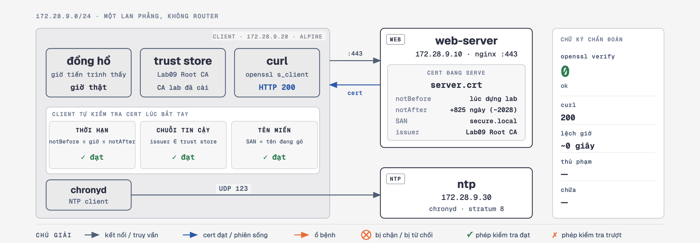

# 🩺 Ca Bệnh 09: Màn Hình Đỏ HTTPS — Chứng Chỉ "Hết Hạn" Mà Vẫn Còn Hạn

> **Hồ sơ ca bệnh:**
> * **Hiện tượng:** Máy chủ ping được, port 443 bắt tay TCP được, nhưng trình duyệt chặn lại bằng màn hình đỏ `Your connection is not private`, hoặc `curl` trả về `curl: (60) certificate has expired`.
> * **Bản chất lỗi:** Sự cố ở **Tầng 5/6 — khâu xác thực chứng chỉ trong bắt tay TLS**. Mọi thứ ở L2/L3/L4 đều đúng tuyệt đối.
> * **Chỗ khiến ca này khó lần:** `"certificate has expired"` **không phải một sự thật tuyệt đối**. Nó là kết quả của một **phép so sánh** giữa hai thứ:
>
>   ```
>   notBefore  <=  ĐỒNG HỒ CỦA BÊN ĐANG KIỂM TRA  <=  notAfter
>   ```
>
>   Sai **vế nào** trong hai vế cũng cho ra **đúng một dòng thông báo lỗi**. Cert thật sự hết hạn, và đồng hồ client chạy vượt lên 8 năm — cả hai đều sinh ra `verify code 10`. Không lệnh nào chạy *trên máy báo lỗi* tách được chúng.

> 🧪 **Buổi học chỉ cần 2 ca chính — cùng một mã lỗi, hai thủ phạm trái ngược:**
>
> | KB | Ca | `openssl verify` | `curl` | Lệch giờ | Thủ phạm |
> | :-- | :--- | :--- | :--- | :--- | :--- |
> | KB1 | Khoẻ (mốc so sánh) | `0 (ok)` | 200 | ~0 | — |
> | **KB2** | **Cert hết hạn thật** | `10` | 60 | **~0** | **SERVER** |
> | **KB3** | **Đồng hồ client sai** | `10` / `9` | 60 | **RẤT LỚN** | **CLIENT** |
>
> 📂 Các ca còn lại (cert chưa hiệu lực, sai tên miền, cert tự ký, hết hạn giữa phiên, chặn NTP) vẫn chạy được, nằm trong [`scripts/mo-rong/`](./scripts/mo-rong/) — dành cho ai muốn học tiếp, không nằm trong luồng chính.

> 📚 **Điều kiện tiên quyết:** Nắm `curl`, `openssl s_client` ở mức cơ bản. Nên học [Tập 06 — DNS](../tap-06-dns-resolution-failure/) và [Tập 08 — Asymmetric Routing](../tap-08-asymmetric-routing/) trước, vì tập này dùng lại đúng phương pháp: **so hai góc nhìn để tìm ra bên nào đang nói dối.**

---

## 🔬 Sơ đồ Kiến trúc Lab



> 🖼️ **Bản HTML tương tác** — 3 tab (khỏe, hết hạn thật, đồng hồ client sai), mỗi tab một kịch bản: cert nào đang được serve, đồng hồ client đang chỉ mấy giờ,
> **phép kiểm tra nào trượt** (thời hạn / chuỗi tin cậy / tên miền) và chữ ký chẩn đoán tương ứng:
> [`so-do-kien-truc.html`](./so-do-kien-truc.html)

* **Client tự phán xét cert rồi tự bỏ cuộc (gửi FIN), không gửi Alert** — xem mục *⚠️ Đính Chính Quan Trọng* bên dưới.
* **Cert được sinh runtime, không commit vào git.** Cert commit sẵn sẽ hết hạn thật vào một ngày nào đó → lab thành "bom hẹn giờ". Cert "hợp lệ" luôn còn hạn; cert "hết hạn" có `notAfter` cố định trong quá khứ nên nó hết hạn **vĩnh viễn**.
* **Container `ntp` là nhân vật quan trọng nhất mà không ai để ý.** Toàn bộ tập này xoay quanh việc đối chiếu đồng hồ. Không có nguồn giờ độc lập thì mọi kết luận đều dựa vào chính cái đồng hồ đang bị nghi ngờ.
* **Client KHÔNG được cấp `CAP_SYS_TIME`.** Container dùng chung đồng hồ kernel với máy thật của bạn — `date -s` trong container là đổi giờ máy bạn. Lab giả lập lệch giờ bằng `faketime` (LD_PRELOAD, chỉ lừa đúng tiến trình được gọi).
* **CA của lab được cài vào trust store của client** (`0-setup.sh` làm việc này). Nhờ vậy lệnh trong lab là `curl https://secure.local/` trần, đúng y ngoài đời — không phải đính `--cacert` vào mọi lệnh.

> 🔑 Cả tập gói trong một câu: **`openssl` nói "hết hạn" KHÔNG có nghĩa là cert hết hạn.**

---

## 🚀 Hướng Dẫn Thực Hành

### Bước 1: Dựng lab

```bash
cd network-bat-benh/tap-09-tls-clock-skew
./scripts/0-setup.sh
```

`0-setup.sh` **idempotent** — chạy lại bất cứ lúc nào để reset sạch. Nó dọn cả những thứ `docker compose restart` không dọn được: luật `iptables` chặn UDP 123 (MR5), phiên `s_client` còn treo và FIFO (MR4), cert ngắn hạn đã chết.

> **Quy tắc bất di bất dịch: sau MỖI kịch bản, chạy lại `./scripts/0-setup.sh`.**

Ba terminal nên mở sẵn suốt buổi:

```bash
# Terminal 1 — chạy kịch bản
./scripts/0-setup.sh

# Terminal 2 — máy đo phía client (nạn nhân)
docker exec -it lab09-client monitor.sh

# Terminal 3 — góc nhìn phía server (nơi phá án)
./scripts/xem-cert.sh
```

`monitor.sh` in mỗi nhịp 5 cột: **giờ client / hạn cert đọc TỪ DÂY / verify / curl**. Để nó chạy rồi bật KB2 — bạn sẽ thấy cột `VERIFY` lật từ `0 (ok)` sang `10` ngay trước mắt.

---

### Bước 2: Chạy một ca bệnh và đọc chữ ký

```bash
./scripts/3-client-lech-gio.sh     # hoặc 1, 2   (ca mở rộng: scripts/mo-rong/)
./scripts/test.sh                  # chẩn đoán 6 bước, tự luận giải
```

`test.sh` chạy được ở **bất kỳ trạng thái nào** của lab và tự chỉ ra kịch bản nào đang chạy.

> ⚠️ **Bước 6 của `test.sh` tự bỏ qua khi cert đang serve đã hỏng sẵn.** Phép thử "một cert, ba đồng hồ" chỉ có nghĩa khi cert **còn hạn** — chạy nó lúc cert đã hết hạn sẽ cho ba lần thất bại giống nhau và không chứng minh được gì.

---

### Bước 3: Bắt gói tin

```bash
./scripts/bat-goi-tls.sh 12        # mặc định ép TLS 1.2 — đọc được nội dung
./scripts/bat-goi-tls.sh 12 13     # đối chứng TLS 1.3 — bị mã hoá gần hết
```

| Display filter | Thấy gì |
| :--- | :--- |
| `tls.handshake.type == 11` | Bản tin **Certificate**. Bung ra → `signedCertificate` → `validity` để đọc đúng hai trường `notBefore` / `notAfter` mà client đem ra so |
| `tls.record.content_type == 21` | Alert — **sẽ KHÔNG khớp gói nào** khi client là curl/openssl. Đọc mục dưới |

---

## ⚠️ Đính Chính Quan Trọng: Wireshark KHÔNG Cho Bạn Thấy `Bad Certificate`

Rất nhiều tài liệu (và **bản cũ của chính README này**) nói rằng khi cert hỏng bạn sẽ thấy gói:

```
Alert (Level: Fatal, Description: Bad Certificate)
```

**Điều đó không đúng với lab này, và thường cũng không đúng ngoài đời.** Ba lý do, cả ba đều **đã được đo bằng `tcpdump` trong chính lab này**:

1. **TLS 1.3 mã hoá cả Alert.** Từ TLS 1.3, mọi bản tin sau `ServerHello` đều nằm trong lớp mã hoá; trên dây alert mang content-type 23 (`application_data`). Wireshark hiện `Encrypted Alert` — không đọc được description.

2. **Client dùng OpenSSL thường không gửi Alert nào cả.** OpenSSL xác thực cert **sau** khi bắt tay xong. Đo thực tế với `curl --tls-max 1.2` và cert hết hạn:

   ```
   client -> ClientKeyExchange + ChangeCipherSpec + Finished
   server -> ChangeCipherSpec + Finished
   client -> FIN            <- không hề có bản tin Alert
   ```

   `openssl s_client` trần còn "dễ" hơn: nó chỉ gửi `close_notify` (warning). Chính **trình duyệt** (BoringSSL/NSS) mới gửi alert thật.

3. **Mã alert đúng là `certificate_expired (45)`**, không phải `bad_certificate (42)`.

👉 **Hệ quả thực tế:** khi gỡ lỗi TLS 1.3 ngoài đời, Wireshark **không** cho bạn biết cert có vấn đề gì. Phải lấy cert bằng đường khác:

```bash
openssl s_client -connect host:443 -servername TEN </dev/null 2>/dev/null \
  | openssl x509 -noout -dates -subject -ext subjectAltName
```

---

## 🌐 Xem Bằng Trình Duyệt — Phải Làm Đúng 2 Bước

Vào thẳng `https://localhost:8443` sẽ **KHÔNG** ra `ERR_CERT_DATE_INVALID`. Nó ra `ERR_CERT_COMMON_NAME_INVALID`, vì cert cấp cho `secure.local` chứ không phải `localhost` — một ca bệnh hoàn toàn khác (MR2).

Muốn thấy **đúng** màn hình đỏ của ca bệnh này:

```bash
# 1. Trỏ tên miền về máy mình (macOS/Linux)
echo "127.0.0.1 secure.local" | sudo tee -a /etc/hosts
#    Windows: C:\Windows\System32\drivers\etc\hosts

# 2. Import CA của lab vào trust store — nếu không, trình duyệt báo
#    ERR_CERT_AUTHORITY_INVALID (lại là một ca bệnh khác, MR3)
#    macOS:
sudo security add-trusted-cert -d -r trustRoot \
     -k /Library/Keychains/System.keychain nginx/ssl/ca.crt

# 3. Bật ca bệnh rồi mở https://secure.local:8443
./scripts/2-cert-het-han.sh
```

> ⚠️ **`docker compose up` sinh CA MỚI mỗi lần.** CA vừa import sẽ thành vô nghĩa sau lần dựng lab tiếp theo — phải import lại. Nhớ **gỡ CA của lab khỏi trust store khi học xong**; đừng để một CA có private key nằm công khai trong `nginx/ssl/ca.key` tiếp tục được máy bạn tin.

---

## 🧠 Bảng Vân Tay — Thứ Đáng Học Thuộc Nhất Tập Này

Toàn bộ số liệu dưới đây **đo trong chính lab này**, không phải con số tham khảo:

```
  openssl verify              curl      lệch giờ   -> Ca bệnh
  --------------------------- --------- ---------- ----------------------------
  0 (ok)                      200       ~0         KHỎE
  10 certificate has expired  exit 60   ~0         KB2 cert HẾT HẠN thật
  10 certificate has expired  exit 60   +8 năm     KB3 ĐỒNG HỒ CLIENT vượt lên
  9  not yet valid            exit 60   ~0         MR1 cert CHƯA HIỆU LỰC
  9  not yet valid            exit 60   -6 năm     KB3 ĐỒNG HỒ CLIENT tụt hậu
  0 (ok)                      exit 60   ~0         MR2 SAI TÊN MIỀN
  18 self-signed certificate  exit 60   ~0         MR3 KHÔNG TIN NGƯỜI KÝ
```

Hai cặp dễ nhầm nhất — và cách tách:

1. **KB2 vs KB3** — `openssl` nói **y hệt** nhau: `10 (certificate has expired)`. Nguyên nhân trái ngược hoàn toàn (server quên gia hạn / client lệch giờ). Không lệnh nào chạy *trên máy báo lỗi* tách được. **Chỉ độ lệch giờ trả lời được**, và độ lệch đó phải đo bằng một nguồn **khác** đồng hồ của chính máy đang nghi ngờ.

   * Lệch ~0 → cert hết hạn thật → **thay cert**.
   * Lệch lớn → cert còn hạn nguyên vẹn → **đồng bộ NTP**. Thay cert ở đây là chữa nhầm người.

2. **MR2 là ca duy nhất hai công cụ NÓI NGƯỢC NHAU** — và công cụ kỹ thuật viên hay tin nhất lại là công cụ sai:

   ```bash
   openssl s_client -connect host:443 -servername secure.local
   # -> Verify return code: 0 (ok)          ❌ SAI, nó không kiểm tra tên miền

   openssl s_client ... -verify_hostname secure.local
   # -> Verify return code: 62 (hostname mismatch)   ✅ sự thật
   ```

   `s_client` **mặc định chỉ kiểm tra chuỗi tin cậy + thời hạn**. Cert cấp cho `other.local` mà bạn hỏi `secure.local` vẫn cho ra `0 (ok)`. **Không bao giờ kết luận "cert OK" bằng `s_client` trần.**

Ba mã lỗi trình duyệt, ba hồ sơ bệnh án khác nhau, một màu màn hình:

| Mã lỗi trình duyệt | So cert với | Kịch bản |
| :--- | :--- | :--- |
| `ERR_CERT_DATE_INVALID` | **đồng hồ** | KB2 / KB3 / MR1 |
| `ERR_CERT_AUTHORITY_INVALID` | **trust store** | MR3 |
| `ERR_CERT_COMMON_NAME_INVALID` | **tên đang gõ** | MR2 |

---

## 🧭 Quy Trình Debug Cert — 5 Bước, Đúng Thứ Tự

```
1. Loại trừ tầng dưới:  nc -zv <host> 443     -> thông = L3/L4 OK, đừng soi mạng nữa.

2. ĐỒNG HỒ HAI ĐẦU:     date -u                              # máy đang báo lỗi
                        curl -sI http://<host>/ | grep -i ^date   # phía server
   ^^^ BƯỚC HAY BỊ BỎ NHẤT VÀ QUAN TRỌNG NHẤT.
   Header `Date:` của HTTP không cần TLS -> vẫn đọc được NGAY CẢ KHI TLS hỏng.
   Đây là nguồn giờ đối chiếu rẻ nhất mà ai cũng có sẵn.

3. SERVER ĐANG SERVE GÌ (đọc từ dây, không đọc file trên đĩa):
      openssl s_client -connect host:443 -servername TEN </dev/null 2>/dev/null \
        | openssl x509 -noout -dates -subject -issuer -ext subjectAltName

4. SO bước 2 với bước 3:
      lệch giờ ~0    -> notBefore/notAfter là SỰ THẬT  -> lỗi ở CERT
      lệch giờ lớn   -> cert có thể vẫn còn hạn        -> lỗi ở ĐỒNG HỒ

5. Nếu bước 3 nói cert OK mà ứng dụng vẫn chết:
      openssl s_client ... -verify_hostname TEN     # lỗi tên miền?
      -> vẫn OK? kiểm tra TRUST STORE của chính ứng dụng đó.
```

> ⚠️ **Bước 2 là bước hay bị bỏ nhất.** Ticket bị đóng nhầm với dòng *"đã kiểm tra, cert hết hạn, đã đặt mua cert mới"* là ticket KB3 — trong đó cert cũ chưa bao giờ có vấn đề gì.

---

## 🕰️ Vì Sao Đồng Hồ Lệch — Và Vì Sao Không Ai Biết

`3-client-lech-gio.sh` cho thấy **triệu chứng**. `mo-rong/mr5-chan-ntp.sh` cho thấy **nguồn gốc**:

* Firewall / security group chỉ mở TCP, **quên mở UDP 123 chiều ra** — lý do số 1.
* Mạng cách ly hoàn toàn, không có NTP server nội bộ nào.
* Cloud image trỏ vào `pool.ntp.org` nhưng VPC không có đường ra Internet.
* `chronyd` / `systemd-timesyncd` bị tắt trong một lần "tối ưu dịch vụ".
* **Hết pin CMOS** — khởi động lại là nhảy về một mốc rất xa.
* VM vừa restore snapshot, đồng hồ đứng ở thời điểm chụp.

Đồng hồ tinh thể trôi khoảng **1–2 giây/ngày** khi không được kéo lại. Nghe không đáng kể — nhưng sau vài tháng là vài phút, và sau một lần hết pin CMOS là **vài năm**. Đó là lúc cert bắt đầu "hết hạn" một cách khó hiểu.

```bash
# Kiểm tra trên máy thật
timedatectl                    # "System clock synchronized: yes/no"
chronyc tracking               # "Leap status: Normal" + độ lệch
chronyc sources -v             # có nguồn nào đang được chọn không
ss -unp | grep :123            # có tiến trình nào đang nói NTP không
```

> 🔇 **Chặn NTP là một sự cố IM LẶNG.** Không alert nào kêu, không log nào đỏ. Nó chỉ lộ diện vài tháng sau, khi đồng hồ đã trôi đủ xa để đẩy cert ra ngoài hạn. Sự cố được **gieo** hôm nay và **nổ** vào một ngày không ai liên hệ được với nguyên nhân.

---

## ⏱️ Bẫy Thực Địa: "Dịch Vụ Vẫn Chạy" Không Chứng Minh Được Gì

`mo-rong/mr4-het-han-giua-phien.sh` đo trực tiếp hiện tượng này. Kết quả thật từ lab:

```
[09:18:18] Bắt tay TLS THÀNH CÔNG — cert lúc này CÒN HẠN
[09:18:59] cert hết hạn
[09:19:05] kết nối MỚI  -> curl: (60) certificate has expired
[09:19:18] PHIÊN CŨ     -> HTTP/1.1 200 OK          <- vẫn sống!
```

**Thời hạn cert chỉ được kiểm tra ĐÚNG MỘT LẦN — lúc bắt tay.** Phiên đã mở thì không ai kiểm tra lại. Nên khi cert hết hạn:

* các kết nối **đang mở**: chạy tiếp bình thường, không ai bị đứt;
* các kết nối **mới**: chết ngay.

Ba hệ quả:

1. **"Web vẫn vào được" không chứng minh cert còn hạn.** Tab đang mở dùng phiên cũ. Phải kiểm tra bằng một **kết nối mới**.
2. **Health-check dùng keep-alive sẽ báo xanh hàng giờ sau khi cert đã chết.** Giám sát cert phải mở kết nối mới mỗi vòng — hoặc tốt hơn, kiểm `notAfter` trực tiếp và cảnh báo trước 30 ngày.
3. Đó là lý do sự cố cert thường bùng ra vào **giờ cao điểm** chứ không phải đúng thời điểm hết hạn — giờ cao điểm là lúc có nhiều kết nối mới nhất.

---

## 📋 Bảng Script

| Script | Ca bệnh | Chữ ký |
| :--- | :--- | :--- |
| `0-setup.sh` | reset sạch lab (idempotent) | — |
| `1-binh-thuong.sh` | trạng thái khoẻ, lấy mốc so sánh | `0 (ok)` + 200 |
| `2-cert-het-han.sh` | server serve cert đã hết hạn | `10` + lệch ~0 |
| `3-client-lech-gio.sh` | ⭐ **cert hợp lệ, đồng hồ client sai** | `10`/`9` + lệch LỚN |
| `mo-rong/mr1-cert-chua-hieu-luc.sh` | cert `notBefore` ở tương lai | `9` + lệch ~0 |
| `mo-rong/mr2-sai-ten-mien.sh` | cert còn hạn nhưng SAN sai | **`0 (ok)` + curl 60** |
| `mo-rong/mr3-ca-khong-tin-cay.sh` | cert tự ký | `18` |
| `mo-rong/mr4-het-han-giua-phien.sh` | cert hết hạn giữa chừng (~85s) | phiên cũ sống, phiên mới chết |
| `mo-rong/mr5-chan-ntp.sh` | chặn UDP 123 — nguyên nhân gốc của KB3 | TLS vẫn xanh |
| `test.sh` | chẩn đoán 6 bước, chạy ở mọi trạng thái | — |
| `bat-goi-tls.sh` | bắt gói ra `.pcap` | — |
| `xem-cert.sh` | góc nhìn phía server (terminal 3) | — |

---

## 📝 Câu Hỏi Ôn Tập

1. `openssl s_client` trả về `Verify return code: 10 (certificate has expired)`. Bạn được phép kết luận cert đã hết hạn chưa? **Lệnh tiếp theo bạn gõ là gì?**
2. Vì sao `openssl s_client` báo `0 (ok)` mà `curl` cùng lúc báo `exit 60`? Sửa lệnh `openssl` thế nào để nó nói thật?
3. Đồng nghiệp báo "đã gia hạn cert rồi mà vẫn lỗi". Có **hai** nguyên nhân rất phổ biến — kể ra và nêu cách kiểm chứng từng cái.
4. Cert hết hạn lúc 2h sáng. Vì sao 9h30 khách hàng mới báo lỗi, và vì sao giám sát vẫn xanh suốt thời gian đó?
5. Máy trạm báo `ERR_CERT_DATE_INVALID`, các máy khác cùng văn phòng thì bình thường. Nghi ngờ đầu tiên của bạn là gì?
6. Vì sao chặn UDP 123 hôm nay lại gây sự cố TLS sau vài tháng chứ không phải ngay lập tức?
7. Trình duyệt báo `ERR_CERT_AUTHORITY_INVALID`. Đồng bộ NTP có chữa được không? Vì sao?

---

## 🧹 Dọn dẹp Lab

```bash
docker compose down
```

> Nếu đã import CA của lab vào trust store để xem bằng trình duyệt, **nhớ gỡ ra**:
> ```bash
> sudo security delete-certificate -c "Lab09 Root CA" /Library/Keychains/System.keychain
> ```
> và xoá dòng `secure.local` khỏi `/etc/hosts`.
